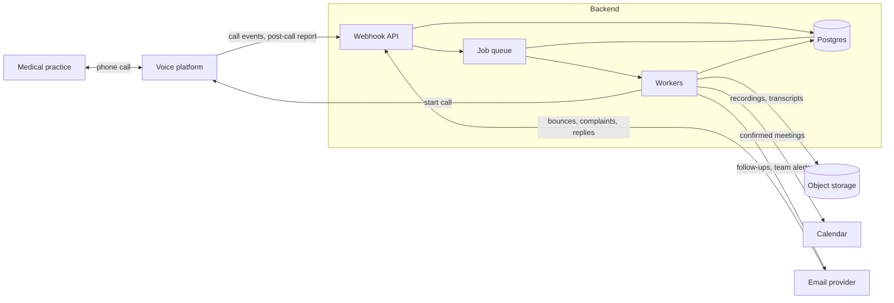

# outbound-voice-agent

I built the backend for an outbound AI voice agent for a US healthcare staffing company. The agent cold-called medical practices. It qualified their interest, booked a meeting with the sales team or started an email follow-up, and honoured opt-outs.

This repository holds the parts of that backend that are plain engineering. The client agreed to a generic showcase, and there is no client data here.

## Architecture



A scheduler job picks the leads that are inside their calling window and asks the voice platform to dial them. When a call ends the platform posts a report to the webhook API. A worker turns that report into actions. It may create a pending meeting, alert the sales team, start an email sequence or add the contact to the suppression list. Bounces, complaints and replies come back through the same API.

I learned early that the model's labels can't be trusted alone. A voicemail greeting can look like a conversation. A receptionist who gives a time to call back can look like a warm lead. Each guard in this repository closes one of those gaps on the server.

## What is in this repository

Every file in `src` is a pure function with small typed inputs. Nothing here touches a database, a phone line, a mailbox or a calendar.

- `calling-window.ts` decides whether a lead may be dialled right now. It works in the lead's local time, allows prospecting calls only on weekdays inside the campaign window and keeps every call inside legal hours.
- `area-code-timezone.ts` finds a lead's timezone from the area code. An unknown code returns nothing, and a lead with no timezone is never dialled.
- `live-human.ts` decides whether a real person spoke. It catches voicemail and phone menus and still allows a menu that leads to a person.
- `call-outcome.ts` turns the model's labels into actions. A booking needs a live human and a stated time. A captured email needs a live human and a valid address. A callback alert needs a decision maker who engaged.
- `appointment-time.ts` turns a phrase like "next Tuesday at 2 PM Eastern" into a time. It also reports whether the caller stated a day or a time at all.
- `variants.ts` gives each lead a weighted A/B variant, such as a voice, and keeps it for every later call.
- `opt-out.ts` reads STOP replies, turns unsubscribes, hard bounces and complaints into suppressions and checks the list before any contact.
- `local-time.ts` does the timezone arithmetic with `Intl`, so there are no dependencies.

Each module has a test file in `test`.

## What it leaves out

There is no client data in this repository. It has no lead lists, recordings or transcripts. It has none of the agent's prompts. The integrations with the voice platform, the email provider, the calendar and object storage are gone, along with the database schema and the jobs that call these functions.

## Run it

Node 22.18 or newer runs the TypeScript directly. There are no dependencies.

```sh
npm install
npm test
```

## Results

The pilot ran across all four US timezones. In the first weeks the agent made 1,337 dials and reached 173 live humans, about 13% of dials. The contact rate was 17.8% per practice. I cut the agent's turn latency from a 3.36 s median to 1.86 s by benchmarking providers. The first genuine meeting bookings came in the first month.
